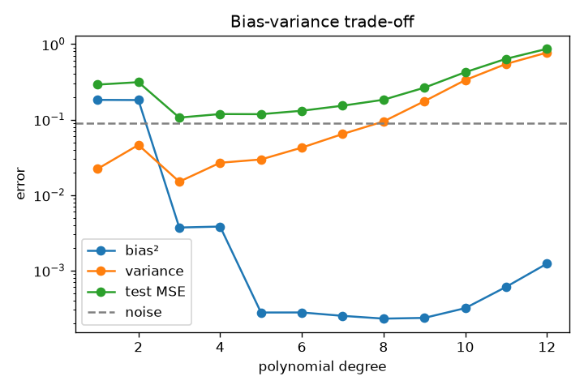
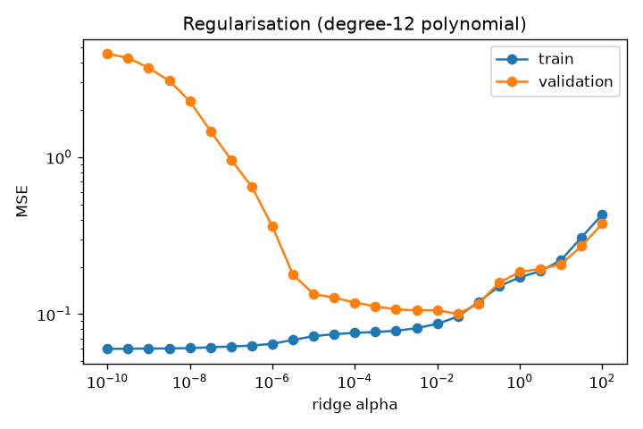

# Bias-variance and regularisation demos

Run `python -m s3_classical_ml.bias_variance.impl` to regenerate the two plots below.

 

## Intuition
Imagine re-collecting the training data many times and refitting the same kind of model.
- **Bias:** how far the *average* fitted model is from the truth. A straight line fitted to a
  sine wave is wrong no matter how much data you get. Too-simple models have high bias.
- **Variance:** how much the fitted model jumps around between datasets. A degree-12 polynomial
  through 30 noisy points wiggles wildly and differently every time. Too-flexible models have
  high variance.
- **Noise:** randomness in the labels that no model can predict.

Test error = bias² + variance + noise. Making a model more flexible trades bias for variance;
the best model sits at the bottom of the U-shaped test-error curve. **Regularisation** is a dial
that moves along the same trade-off without changing the model family.

## Core math
For squared loss at an input x, with `f` the truth and `f̂_D` the model trained on dataset D:
`E_D,ε[(y − f̂_D(x))²] = (E_D[f̂_D(x)] − f(x))² + Var_D[f̂_D(x)] + σ²`.
The demo estimates each term by Monte Carlo over 200 training sets (`impl.py`), and checks
that they add up to a directly measured test error.

Regularisation demo: ridge on degree-12 polynomial features. As α grows, training error rises
monotonically and the weight norm shrinks; validation error first falls (less variance) then rises
(more bias).

## Results (from the tests / plots)
- Degree 1: high bias, tiny variance. Degree 4: both small (best). Degree 12: variance dominates.
- Validation-optimal α lies strictly inside the swept range and cuts validation MSE by > 30%
  versus both extremes.

## Complexity
Monte Carlo cost: `n_datasets × cost(fit)`.

## Common pitfalls
- Confusing training error with test error (training error only falls with complexity).
- Believing more data fixes bias (it fixes variance; bias needs a richer model).
- Thinking the decomposition is exact for 0-1 loss (it is cleanest for squared loss).
- Deep networks show "double descent" where very over-parameterised models generalise again;
  the classic U-curve is not the whole story there.

## When to use vs. alternatives
- Diagnose with learning curves: big train/val gap → variance (more data, regularise, simpler
  model, bagging); both errors high → bias (richer model, better features, boosting).

## Interview questions
1. **Define bias and variance.** Error of the average model vs spread of models across datasets.
2. **How do you tell if a model has high bias or high variance?** Compare training and validation
   error (learning curves).
3. **How does regularisation affect the trade-off?** Increases bias, decreases variance.
4. **Bagging vs boosting in this language?** Bagging reduces variance; boosting reduces bias.
5. **Does more data help a high-bias model?** Not much; it mostly reduces variance.
