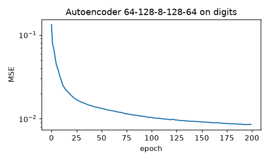

# Autoencoder

**Final metric:** 64→128→**8**→128→64 autoencoder (ReLU, sigmoid output, Adam, 200 epochs) on
8×8 digits. Test reconstruction MSE **0.0116**, versus 0.0249 for PCA with 8 components and
0.0734 for predicting the mean image. A 5-NN classifier on the 8-number codes (no labels used in
training) reaches **0.960** test accuracy. A *linear* autoencoder matches PCA's error to within 5%
(tested), as theory predicts. A denoising variant (σ = 0.3 input noise) removes over 70% of the
noise's squared error.

## Intuition
Squeeze the data through a narrow bottleneck and ask the network to rebuild it on the other side.
To succeed, the 8 numbers in the middle must capture what matters about each digit (stroke shape,
thickness, slant) and drop what doesn't. The encoder half becomes a learned compressor and feature
extractor, without any labels.

- **Linear autoencoder** ⇔ PCA: same subspace, same error.
- **Non-linear** autoencoders can follow curved structure in the data, so the same 8 numbers keep more.
- **Denoising** autoencoders get a corrupted input but must output the clean one, so they learn
  what real digits look like rather than copying pixels.

## Core math
- `z = f_enc(x)`, `x̂ = f_dec(z)`, loss `‖x − x̂‖²` (or BCE for [0,1] pixels).
- Linear case: optimum spans the top-k principal subspace (Baldi & Hornik), error =
  sum of the discarded eigenvalues.
- Denoising: minimise `E‖x − f(x + ε)‖²`; with small Gaussian noise the optimal `f(x̃) − x̃` points
  along the gradient of the data log-density (the link to score matching / diffusion models).

## Complexity
Same as an MLP of the same size: O(batch · parameters) per step.

## Common pitfalls
- A bottleneck that is too wide (or an overcomplete AE without regularisation) learns the identity.
- Comparing reconstruction losses computed with different reductions (sum vs mean).
- The latent space of a plain AE is not organised for *sampling*: random codes decode to garbage
  (that is what the VAE fixes).
- Sigmoid outputs with MSE learn slowly near saturation; BCE is a common alternative.

## When to use vs. alternatives
- Dimensionality reduction with non-linear structure, anomaly detection (high reconstruction
  error = unusual), denoising, unsupervised pre-training of features.
- Linear structure → PCA (closed form, no tuning). Generating new samples → VAE, GAN, diffusion.

## Interview questions
1. **How is an autoencoder related to PCA?** A linear AE with squared error learns the same
   subspace as PCA (but not necessarily orthonormal axes).
2. **How do you stop an autoencoder learning the identity?** A narrow bottleneck, noise
   (denoising), sparsity or contractive penalties.
3. **How would you use an AE for anomaly detection?** Train on normal data; flag inputs with large
   reconstruction error.
4. **Why can't you sample new data from a plain AE?** Its code space has no known distribution and
   has holes; random codes are off the data manifold.
5. **What does a denoising AE learn?** To map corrupted points back onto the data manifold, which
   approximates the score (gradient of log-density).
