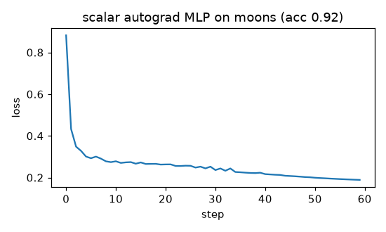

# Scalar autograd engine (micrograd-style)

**Final metric:** a 2→16→16→1 tanh MLP built only from `Value` objects, trained for 60 steps of
SGD with hinge loss on 100 `make_moons` points: training loss 0.19, **accuracy 0.92**
(majority baseline 0.50; a linear classifier ≈ 0.85). Regenerate with
`pytest -m slow s4_deep_learning/autograd_scalar`.

## Intuition
Backpropagation is just the chain rule, applied automatically. Each `Value` is a number that
remembers *how it was made* (which inputs, which operation). Computing a loss therefore builds a
graph. To get gradients, start at the loss with gradient 1 and walk the graph backwards; every
node passes gradient to its inputs, multiplied by its own local derivative.

Every node only needs to know its **local** rule:
- `+` copies the gradient to both inputs;
- `*` sends each input the gradient times the *other* input;
- `tanh` multiplies by `1 − tanh²`; and so on.

## Core math
- Chain rule: if `L` depends on `x` through `y`, `∂L/∂x = ∂L/∂y · ∂y/∂x`.
- If `x` is used in several places, contributions **add**: `∂L/∂x = Σ_paths …` — hence `+=`.
- Reverse topological order ensures a node's gradient is complete before it is propagated.
- Reverse mode costs about one extra forward pass regardless of the number of parameters, which
  is why it (not forward mode or finite differences) is used for training.

## Complexity
Forward and backward are each O(number of graph nodes). Memory O(nodes): the whole graph is kept
until `backward`. Scalar graphs are *very* slow (one Python object per multiply), which is the
motivation for the tensor engine in the next folder.

## Common pitfalls
- Overwriting (`=`) instead of accumulating (`+=`) gradients: wrong when a value is reused.
- Forgetting `zero_grad()` between steps: gradients from previous steps pile up.
- Recursive topological sort overflows Python's stack on deep graphs (iterative here).
- Using `relu`'s derivative at exactly 0 (we choose 0).
- Mutating `.data` of a value after building the graph changes what backward sees.

## When to use vs. alternatives
- For learning and testing ideas only. Real work: PyTorch / JAX (tensor-level autograd, GPU,
  fused kernels). Symbolic differentiation (SymPy) gives formulas but blows up in size.

## Interview questions
1. **What is reverse-mode autodiff and why is it used for neural nets?** It computes the gradient
   of one scalar w.r.t. all inputs in one backward pass; nets have one loss and millions of inputs.
2. **Why accumulate gradients with `+=`?** A variable used in several places receives gradient
   along every path; the multivariable chain rule sums them.
3. **Why topological order?** A node may propagate only after all of its consumers have
   contributed to its gradient.
4. **Autodiff vs numerical vs symbolic differentiation?** Autodiff is exact up to float error and
   cheap; numerical is approximate and O(#params) evaluations; symbolic produces expressions that
   can explode in size.
5. **What does `zero_grad` do and why is it needed?** Resets accumulated gradients; otherwise each
   step would use the sum of all previous gradients.
