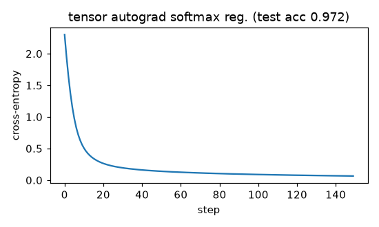

# Tensor autograd engine (NumPy)

**Final metric:** softmax regression (64→10) built from `Tensor` ops and trained with our Adam for
150 full-batch steps on sklearn digits: training loss 0.065, **test accuracy 0.972** on 397
held-out images (majority-class baseline ≈ 0.11).

## Intuition
The scalar engine works but needs one Python object per number. A tensor engine keeps the same
graph-and-chain-rule idea, but each node holds a whole array, so `X @ W` is one node instead of
millions. The backward rule for each operation becomes a *matrix* formula.

The one genuinely new idea is **broadcasting**: adding a bias of shape `(10,)` to activations of
shape `(batch, 10)` silently copies the bias across the batch. In reverse, every copy received
some gradient, so the bias's gradient is the **sum over the batch axis**. `_unbroadcast` does that
for any shapes.

## Core math (backward rules, `G` = upstream gradient)
| forward | gradient to inputs |
|---|---|
| `C = A + B` | `G`, `G` (then unbroadcast) |
| `C = A * B` | `G * B`, `G * A` |
| `C = A @ B` | `G @ Bᵀ`, `Aᵀ @ G` |
| `y = sum(x, axis)` | broadcast `G` back over `axis` |
| `y = max(x, axis)` | `G` to the arg-max positions only |
| `y = x[idx]` | scatter-add `G` into zeros (`np.add.at` handles repeated indices) |
| `y = f(x)` elementwise | `G * f'(x)` |
| `log_softmax(x)` | `x − logsumexp(x)`; built from the ops above, with the max subtracted |

Optimisers: SGD with momentum and L2 weight decay; Adam with decoupled weight decay (AdamW).
Both are tested step-for-step against PyTorch.

## Complexity
Backward costs roughly the same as forward (about 2× FLOPs for matmul). Memory holds every
intermediate array until `backward`, which is why activation memory dominates training.

## Common pitfalls
- Forgetting to unbroadcast → gradient with the wrong shape (or silently wrong values).
- Using `g[idx] += …` instead of `np.add.at` → repeated indices count once.
- Computing gradients for constants (wasted memory); `requires_grad` controls this.
- Shape conventions of matmul with 1D operands.
- In-place modification of arrays that the backward pass still needs.

## When to use vs. alternatives
- Educational, and fine for small CPU models. PyTorch adds GPU kernels, fused ops, memory
  planning, mixed precision, and higher-order gradients.

## Interview questions
1. **Gradient of `A @ B` w.r.t. `A`?** `G @ Bᵀ` (check shapes: `(m,n)·(n,k)ᵀ… → (m,k)(k,n) = (m,n)`).
2. **How do you handle broadcasting in backward?** Sum the gradient over the broadcast axes until
   it matches the input's shape.
3. **Why is reverse mode memory-hungry?** It stores all forward activations to use in the
   backward pass; gradient checkpointing trades compute for memory.
4. **Why is `log_softmax` implemented as `x − logsumexp(x)`?** Numerical stability; and its
   gradient becomes the simple `softmax − one_hot` combination.
5. **L2 weight decay vs decoupled weight decay?** Same for SGD; for Adam, L2 in the gradient gets
   rescaled by the adaptive denominator, so AdamW applies decay directly to the weights.
