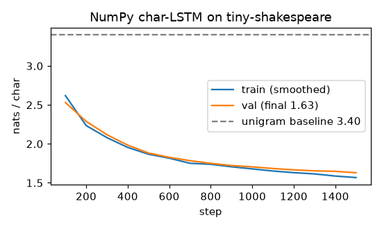

# Character-level language model (NumPy LSTM)

**Final metric:** embedding(32) → LSTM(128) → linear, trained for 1,500 steps (batch 32, 64
characters per sequence, Adam lr 3e-3, gradient clipping at norm 5) on the first 300k characters
of tiny-shakespeare, ~35 s on a laptop CPU. **Validation loss 1.63 nats/char** (perplexity ≈ 5.1)
vs **3.40** for a unigram (character-frequency) baseline. A sample is in [`sample.txt`](sample.txt):
it has learned speaker names, line breaks, and word-like spelling, but not meaning.

Data: `data_utils.tiny_shakespeare()` downloads the 1.1 MB file once into `data/` (gitignored).

## Intuition
Read text one character at a time and, at every position, guess the next character. The LSTM's
hidden state is the model's memory of what it has read so far. Training pushes up the probability
of the character that actually came next. To generate, feed the model its own guesses one at a
time.

**Temperature** reshapes the guess distribution before sampling: below 1 it plays safe (repetitive
text), above 1 it takes risks (creative but misspelled); 0 means always take the most likely character.

## Core math
- `P(c_{t+1} | c_{≤t}) = softmax(W_out hₜ + b)`, loss = mean `−log P(true next char)` (nats/char);
  perplexity = `e^{loss}`, bits/char = `loss / ln 2`.
- Embedding backward: rows of `E` receive the *sum* of gradients from every position that used them.
- **Truncated BPTT:** train on random 64-character windows instead of the full 300k-long sequence.
- **Gradient clipping:** if `‖g‖ > τ`, rescale `g ← g·τ/‖g‖` (direction kept, size capped).
- Sampling: `p = softmax(logits / T)`.

## Complexity
Per step O(T · N · H · (D + H + V)); generation is O(H · (D + H + V)) per character, strictly sequential.

## Common pitfalls
- Off-by-one between inputs and targets (targets are inputs shifted by one).
- Evaluating on windows that overlap the training text (use a held-out tail).
- Exploding gradients early in training without clipping.
- Comparing losses in nats vs bits.
- Sampling with temperature 0 loops forever on a repeated phrase.

## When to use vs. alternatives
- Character-level models need no tokenizer and handle any spelling, but sequences are long.
- Subword tokens (BPE, `s5_nlp/tokenization`) + transformers (`s5_nlp/gpt`) are the modern default:
  shorter sequences, parallel training, far better long-range modelling.

## Interview questions
1. **What is perplexity?** `exp(average cross-entropy)`: the effective number of equally likely
   choices the model is torn between.
2. **What does temperature do?** Divides logits before softmax; lower sharpens, higher flattens.
3. **Why truncate BPTT?** Memory and compute grow with sequence length; truncation trades
   very-long-range credit assignment for feasibility.
4. **Why clip gradients in RNNs?** Repeated multiplication through time can produce huge gradients
   that wreck the weights in one step.
5. **Character vs word vs subword models?** Characters: tiny vocab, long sequences. Words: short
   sequences, huge vocab and out-of-vocabulary problems. Subwords: the practical middle ground.
