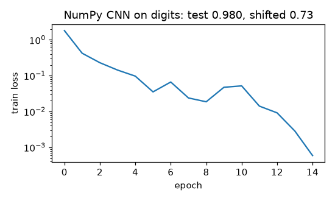

# CNN: conv2d (im2col), pooling, a small CNN on digits

**Final metric:** NumPy CNN (conv3×3·16 → pool → conv3×3·32 → pool → 128 → 10), 15 epochs of SGD
on sklearn's 8×8 digits: **test accuracy 0.980**. A plain 64→64→10 MLP gets 0.987 on the same
centred digits, so on images this tiny the CNN has no edge in raw accuracy. The difference shows
when the test digits are **shifted by one pixel**: the CNN keeps **0.735** average accuracy, the
MLP collapses to **0.439**. Weight sharing and pooling build in (approximate) translation
invariance; the MLP has to learn each position separately.

## Intuition
A convolution slides a small filter (say 3×3) over the image and, at every position, computes a
weighted sum of the pixels under it. The *same* weights are used everywhere, so a filter that
detects "a vertical edge" detects it anywhere in the image. Stacking conv layers builds features
from small (edges) to large (strokes, digits). **Pooling** keeps the strongest response in each
small window, shrinking the image and making the output less sensitive to exact positions.

**im2col** is the speed trick: copy every 3×3 patch into a column of a big matrix, and the whole
convolution becomes a single matrix multiplication (which BLAS does very fast).

## Core math
- Output size: `⌊(H + 2·pad − k)/stride⌋ + 1`.
- `out[n,f,r,c] = b_f + Σ_{c',i,j} W[f,c',i,j] · x[n,c',r·s+i,c·s+j]`.
- im2col: `cols` of shape `(N, C·k·k, L)`; `out = W_flat @ cols + b`.
- Backward: `∂W = Σₙ Gₙ colsₙᵀ`, `∂b = Σ G`, `∂x = col2im(W_flatᵀ G)`; `col2im` scatter-*adds*
  because overlapping patches share pixels (it is the adjoint of im2col; tested).
- Max pool: gradient goes only to the arg-max of each window; avg pool spreads it evenly.
- Parameters: `C_out·C_in·k² + C_out`, independent of image size.

## Complexity
Conv forward: O(N · C_out · C_in · k² · H_out · W_out) multiply-adds. im2col memory:
O(N · C_in · k² · H_out · W_out) — k² times the input, the price of the single big matmul.

## Common pitfalls
- Off-by-one output sizes with stride/padding.
- In col2im, assigning instead of adding when patches overlap.
- Mixing up (N, C, H, W) and (N, H, W, C) layouts.
- Max-pool gradients with ties (we pick the first max, like PyTorch).
- CNNs are translation-*equivariant* by design but not rotation/scale invariant; augment the data.

## When to use vs. alternatives
- Images, audio spectrograms, any grid data with local structure → CNNs.
- Very large datasets / long-range relationships in images → vision transformers.
- Tiny or tabular inputs → MLP or trees (as the centred-digits result shows).

## Interview questions
1. **Why do CNNs need fewer parameters than MLPs on images?** Local connectivity and weight
   sharing: one small filter is reused at every position.
2. **What is im2col and why use it?** Unrolling patches into columns so convolution becomes one
   GEMM; costs extra memory.
3. **Output size of a conv layer?** `⌊(H + 2p − k)/s⌋ + 1`.
4. **What does pooling do?** Downsamples and adds local translation invariance; gradient flows
   only through the max (max pool).
5. **What is the receptive field?** The region of the input that influences one output unit; it
   grows with depth, kernel size, stride and pooling.
