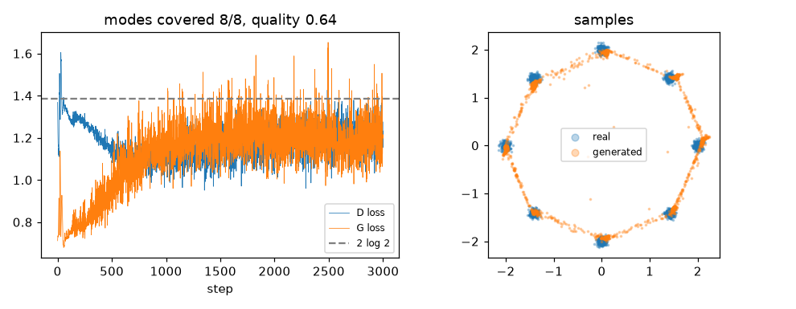

# GAN on 2D toy data

**Final metric:** MLP generator (2-D noise → 128 → 128 → 2) and discriminator, non-saturating
loss, Adam (lr 1e-3, β₁ 0.5), batch 256, 3,000 steps (~5 s on CPU), learning a ring of 8 tight
Gaussians (σ = 0.05). **All 8/8 modes covered**; **64%** of generated points land within 3σ of a
true centre (untrained generator: ≤ 1 mode, < 5%). The remaining points form thin "bridges"
between neighbouring modes (visible in the plot): a continuous generator can't jump between
separated blobs without passing through the gaps.

## Intuition
Two networks play a game. The **generator** turns random noise into fake data points. The
**discriminator** looks at a point and guesses "real or fake?". The discriminator is trained to
catch fakes; the generator is trained to fool the discriminator. If both play well, the fakes
become indistinguishable from real data. At that point the discriminator can only guess, its
output is ½ everywhere, and its loss is `2 log 2 ≈ 1.39` (the dashed line).

## Core math
- Minimax objective: `min_G max_D E_x[log D(x)] + E_z[log(1 − D(G(z)))]`.
- For a fixed G the optimal discriminator is `D*(x) = p_data / (p_data + p_G)`; plugging it in,
  G minimises `2·JS(p_data ‖ p_G) − log 4`.
- **Non-saturating generator loss** `−log D(G(z))`: same fixed point, but it gives big gradients
  when D confidently rejects the fakes (early training), where `log(1 − D(G(z)))` is flat.
- Alternating updates; `fake.detach()` for the D step so G is not updated by D's loss.

## Complexity
Two forward/backward passes per step; no likelihood is computed.

## Common pitfalls
- **Mode collapse:** G produces only a few modes that currently fool D. Diagnose with
  coverage metrics like `mode_metrics`; mitigate with minibatch discrimination, WGAN-GP, unrolled D.
- Losses do not tell you sample quality; they oscillate around an equilibrium (left plot).
- D too strong → vanishing G gradients (use non-saturating loss); D too weak → G learns nothing.
- Forgetting `detach()` (G is pushed to help D) or using BatchNorm carelessly in D.
- Very sensitive to learning rates, β₁, and architecture.

## When to use vs. alternatives
- Sharp image synthesis, image-to-image translation, super-resolution (historically).
- Today diffusion models usually win on quality and stability; VAEs give likelihoods and
  smooth latents; normalising flows give exact likelihoods.

## Interview questions
1. **What does the discriminator converge to at equilibrium?** `D(x) = ½` everywhere when
   `p_G = p_data`.
2. **Why the non-saturating generator loss?** The original loss has near-zero gradient when D
   easily rejects fakes; `−log D(G(z))` is steep there.
3. **What is mode collapse and how do you detect it?** The generator covers only some modes of the
   data; measure coverage/diversity (e.g. modes hit, recall metrics).
4. **What does the original GAN objective minimise?** Jensen–Shannon divergence (up to constants)
   when D is optimal.
5. **GAN vs VAE?** GANs: sharp samples, no likelihood, unstable training. VAEs: stable, likelihood
   bound, blurrier samples.
