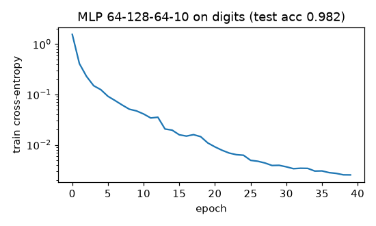

# MLP with backprop, activations, Xavier/He initialisation

**Final metric:** 64→128→64→10 ReLU MLP, He init, mini-batch SGD + momentum (lr 0.05, batch 64,
40 epochs) on sklearn digits: training loss 0.0025, **test accuracy 0.982** on 397 held-out
images (majority baseline ≈ 0.11; softmax regression in `autograd_tensor` reaches 0.972).

## Intuition
An MLP is a stack of "linear map, then bend": `Linear → activation → Linear → activation → …`.
Without the bends (activations) the whole stack collapses into one linear map; with them it can
carve curved decision boundaries (the moons test shows a linear model failing where a two-hidden-layer
net succeeds).

Backprop by hand: each layer stores what it saw in the forward pass, and in the backward pass
turns "gradient w.r.t. my output" into "gradient w.r.t. my input" (plus gradients for its own
weights). Chaining the layers in reverse gives every gradient in one sweep.

**Initialisation matters** because signals are multiplied by a weight matrix at every layer. If
weights are slightly too small the signal shrinks exponentially with depth (vanishing); slightly
too big and it explodes. Xavier and He pick the variance that keeps the signal's scale constant.

## Core math
- Linear `y = xW + b`: `∂W = xᵀG`, `∂b = Σ_batch G`, `∂x = GWᵀ`.
- Activations (`∂x = G ⊙ f'(x)`): ReLU `1[x>0]`; leaky ReLU `1` or `α`; tanh `1 − tanh²`;
  sigmoid `σ(1 − σ)`; GELU (tanh approx.) derivative in `impl.py`.
- Softmax + cross-entropy: `∂logits = (softmax − onehot)/batch`.
- Variance propagation: `Var(y) = fan_in · Var(w) · Var(x)` (times ½ after ReLU).
  - Xavier: `Var(w) = 2/(fan_in + fan_out)` — tanh/sigmoid/linear.
  - He: `Var(w) = 2/fan_in` — ReLU family.
- Test: 20 ReLU layers keep activation std ≈ 1 with He init but shrink ~100× with Xavier.

## Complexity
Forward and backward: O(batch · Σ fan_in·fan_out) each. Memory: activations of every layer.

## Common pitfalls
- All-zero initialisation: every hidden unit stays identical forever (symmetry is never broken).
- Sigmoid/tanh in deep nets: derivatives ≤ 0.25 / ≤ 1 multiply up → vanishing gradients.
- Dead ReLUs: a unit whose input is always negative never updates (leaky ReLU, lower lr, He init).
- Forgetting to sum the bias gradient over the batch.
- Applying softmax before a loss that expects logits.
- Learning rate too high with momentum → divergence.

## When to use vs. alternatives
- Tabular data where boosting is not available or as a component in bigger models.
- Images → CNNs; sequences → RNNs/transformers; small tabular data → gradient boosting usually wins.

## Interview questions
1. **Why do neural nets need non-linear activations?** A composition of linear maps is linear.
2. **Why not initialise weights to zero?** Hidden units would compute identical outputs and
   receive identical gradients forever.
3. **Xavier vs He?** Xavier assumes a symmetric, roughly linear activation; He doubles the variance
   to compensate for ReLU zeroing half the inputs.
4. **What are vanishing/exploding gradients?** Gradients scale like a product of per-layer factors;
   if those are < 1 or > 1 the product decays or blows up exponentially with depth.
5. **Why is ReLU popular?** Cheap, non-saturating for positive inputs (gradient 1), sparse
   activations; downside: dead units.
