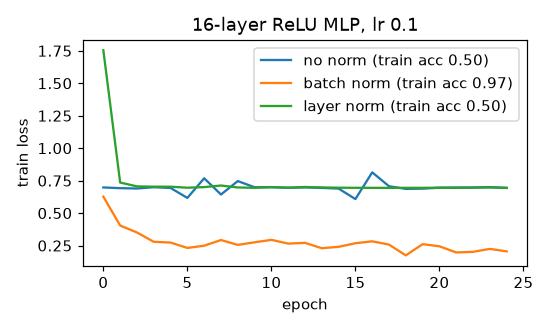

# Batch norm and layer norm

**Final metric:** a 16-layer ReLU MLP (width 64, Xavier init, which is too small for ReLU) trained
for 25 epochs at lr 0.1 on a 2D non-linear classification task (1,000 points):

| | final train loss | train accuracy |
|---|---|---|
| no normalisation | 0.694 (= log 2, stuck) | 0.50 |
| **batch norm** | 0.205 | **0.97** |
| layer norm | 0.694 (stuck) | 0.50 |

At depth 8 and lr 0.02 all three train (accuracy 0.97 / 0.98 / 0.96). So in this small MLP, batch
norm's benefit is that it makes training **robust to depth and learning rate**; layer norm did not
rescue the badly-initialised deep net. Layer norm's strengths show up in transformers (sequence
models, small or variable batch sizes), where it is the standard choice.

## Intuition
As earlier layers learn, the distribution of inputs to later layers keeps shifting and can drift
to very large or very small scales. Normalisation re-centres and re-scales activations at every
layer so each layer always sees inputs with a sensible scale, then lets the network learn its own
preferred scale and offset (`γ`, `β`).

- **Batch norm:** for each feature, normalise using the mean and variance **across the batch**.
- **Layer norm:** for each sample, normalise **across its features**. No dependence on other
  samples, identical at training and test time.

## Core math
`x̂ = (x − μ)/√(σ² + ε)`, `y = γ x̂ + β`.
- BN: μ, σ² over the batch axis (per feature); running averages
  `r ← (1 − m) r + m · stat` used at evaluation (unbiased variance, as in PyTorch).
- LN: μ, σ² over the feature axis (per sample).
- Backward (both, means over the normalised axis):
  `∂x = (1/σ)·(g − mean(g) − x̂·mean(g·x̂))` with `g = ∂y · γ`;
  `∂γ = Σ ∂y·x̂`, `∂β = Σ ∂y`. Verified against PyTorch and finite differences.

## Complexity
O(activations) for both passes; negligible next to the matmuls.

## Common pitfalls
- BN at evaluation must use running statistics (`model.eval()`); forgetting this gives
  batch-dependent predictions.
- BN with tiny batches: noisy statistics (use LayerNorm/GroupNorm).
- Forgetting the `ε`, or computing the backward pass as if μ and σ were constants (that is only
  correct in eval mode).
- Weight decay on `γ`/`β` usually hurts; exclude them.
- BN + dropout ordering can shift variance between train and test.

## When to use vs. alternatives
- CNNs with reasonable batch sizes → BatchNorm. Transformers/RNNs, batch size 1, or online
  inference → LayerNorm (or RMSNorm, which drops the mean subtraction). Small-batch vision → GroupNorm.

## Interview questions
1. **BN vs LN?** BN normalises each feature over the batch; LN normalises each sample over its
   features. LN is batch-independent, identical at train and test.
2. **Why the learnable γ and β?** So the layer can undo the normalisation if that is optimal;
   normalisation should not restrict what the network can represent.
3. **What changes between training and inference in BN?** Batch statistics are replaced by
   running averages accumulated during training.
4. **Why does BN allow higher learning rates?** It keeps activations well scaled, so the loss
   landscape is smoother and updates are less likely to blow up.
5. **Why do transformers use LayerNorm?** Variable sequence lengths, small per-device batches, and
   autoregressive inference make batch statistics impractical.
