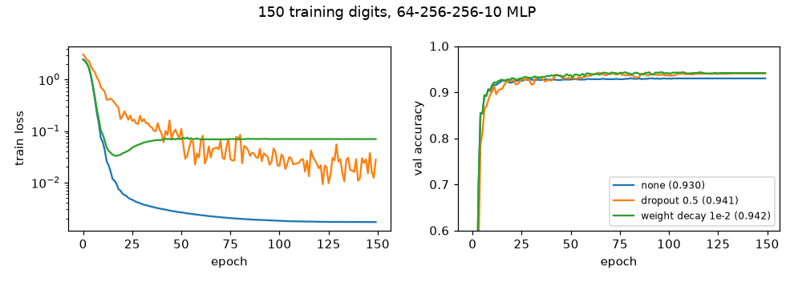

# Dropout, weight decay, learning-rate schedules

**Final metric:** a deliberately oversized 64→256→256→10 MLP trained on only **150** digit
images (150 epochs, cosine schedule with warm-up), validation accuracy averaged over the last 10
epochs on 1,197 held-out images:

| setting | final train loss | val accuracy |
|---|---|---|
| no regularisation | 0.0017 (memorised) | 0.930 |
| dropout 0.5 | 0.028 | **0.941** |
| weight decay 1e-2 | 0.070 | **0.942** |

## Intuition
A big network can memorise a small training set (training loss → 0) and then generalise worse.
Regularisation makes memorising harder or less attractive:
- **Dropout:** randomly switch off units during training, so the network cannot rely on any one
  unit and must spread knowledge redundantly. It behaves like averaging many thinned networks.
- **Weight decay:** add a small pull toward zero on every weight; large weights are needed to fit
  noise sharply, so the network prefers smoother functions.
- **Learning-rate schedules:** big steps early to make progress, small steps late to settle.
  Warm-up starts small because the first updates on random weights are unreliable.

## Core math
- Inverted dropout: `mask ~ Bernoulli(1 − p)`, `y = x · mask / (1 − p)` so `E[y] = x`; at test
  time `y = x`. Backward multiplies by the same mask.
- Weight decay: minimise `L + (λ/2)‖W‖²` ⇒ gradient `g + λW` ⇒ update `W ← (1 − ηλ)W − ηg`.
  With Adam use decoupled weight decay (AdamW; see `autograd_tensor`).
- Schedules: step `η₀ γ^⌊t/k⌋`; exponential `η₀ γᵗ`; cosine with warm-up
  `η₀ (t+1)/w` then `η_min + ½(η₀ − η_min)(1 + cos(π·progress))` (matches PyTorch, tested).

## Complexity
Dropout: O(activations) per step for the mask. Weight decay: O(parameters). Schedules: O(1).

## Common pitfalls
- Leaving dropout on at evaluation (call `model.eval()`), or using non-inverted dropout without
  rescaling at test time.
- Decaying biases and normalisation parameters (usually excluded).
- L2 inside Adam ≠ weight decay; use AdamW.
- Too much dropout on small layers or before batch norm (variance shift).
- Comparing runs with different schedules for different numbers of steps.

## When to use vs. alternatives
- Weight decay: almost always (small value). Dropout: large fully-connected layers, transformers
  (attention/residual dropout), less common in modern CNNs (batch norm + augmentation instead).
- Other regularisers: data augmentation, early stopping, label smoothing, mixup, smaller models.
- Schedules: cosine + warm-up for transformers; step decay / one-cycle for CNNs.

## Interview questions
1. **Why scale by 1/(1 − p) in dropout?** So expected activations match between training and
   test, letting inference skip dropout entirely.
2. **How is dropout an ensemble?** Each mask defines a sub-network sharing weights; test-time
   scaling approximates averaging their predictions.
3. **What does weight decay do to the update?** Multiplies weights by `(1 − ηλ)` each step before
   the gradient step: exponential shrinkage toward zero.
4. **Why warm up the learning rate?** Early gradients (and Adam's moment estimates) are noisy and
   can push weights into bad regions; warm-up stabilises training, especially for transformers.
5. **Early stopping as regularisation?** Stopping when validation loss stops improving limits how
   far weights move from initialisation, similar in effect to L2.
