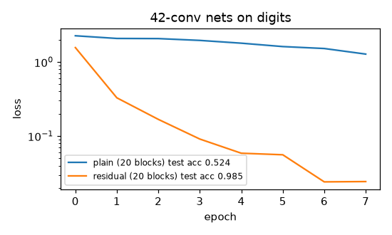

# ResNet block (PyTorch)

**Final metric:** two 42-conv-layer networks (stem + 20 basic blocks + 1 downsampling block,
batch norm everywhere) trained identically for 8 epochs on 8×8 digits (SGD + momentum, lr 0.05):

| | final train loss | test accuracy |
|---|---|---|
| plain (no skip connections) | 1.28 | 0.524 |
| **residual** | 0.024 | **0.985** |

At initialisation (30 blocks), the gradient at the first block is **9,200×** the gradient at the
last block in the plain net, but only **4.9×** in the residual net (tested).

## Intuition
Making a network deeper should never hurt: the extra layers could just copy their input. In
practice plain deep networks train *worse* than shallow ones (the "degradation problem"),
because learning an exact identity through convolutions and ReLUs is hard, and gradients get
badly scaled as they pass through dozens of layers.

A residual block adds its input back to its output: `out = F(x) + x`. Now "do nothing" just means
`F(x) = 0`, which is easy. And in the backward pass the `+ x` path gives the gradient a direct
route to every earlier layer.

Surprise from this experiment: with batch norm, the plain net's gradients did not *vanish*, they
**exploded** going backwards (batch norm in deep plain nets is known to cause this). Either way, the
gradient scale varies over orders of magnitude, and skip connections fix it.

## Core math
- `y = ReLU(F(x) + S(x))`, with `S` = identity, or a 1×1 conv + BN when the shape changes.
- Backward: `∂L/∂x = ∂L/∂y · (∂F/∂x + I)`; the `I` term means the gradient can always flow
  through unchanged, so a stack of blocks has Jacobian `Π (I + ∂Fₖ/∂x)` instead of `Π ∂Fₖ/∂x`.
- Zero-init trick: setting the last BN's γ to 0 makes every block start as the identity (tested).
- Global average pooling before the classifier removes the dependence on spatial size.

## Complexity
Same as a plain CNN of the same depth; the identity shortcut is free, a projection shortcut adds
a 1×1 conv.

## Common pitfalls
- Adding tensors with different shapes: use a projection shortcut when channels/stride change.
- Putting the ReLU before the addition on the identity path (changes the "pre-activation" design).
- Conv bias before BN is redundant (BN subtracts the mean).
- Comparing plain vs residual with different optimisers/epochs.

## When to use vs. alternatives
- Any deep network: skip connections are now everywhere (ResNets, U-Nets, transformers' residual
  stream). Variants: bottleneck blocks (1×1–3×3–1×1) for deeper ResNets, pre-activation ResNets,
  DenseNets (concatenate instead of add).

## Interview questions
1. **What problem do residual connections solve?** Degradation of very deep plain nets: hard
   optimisation and badly scaled gradients; they make identity mappings easy.
2. **Why does `F(x) + x` help gradients?** The derivative contains an identity term, giving a
   direct path for the gradient through every block.
3. **What if input and output shapes differ?** Use a projection shortcut (1×1 conv with stride).
4. **Why global average pooling?** Fewer parameters than flattening, and works for any input size.
5. **How are transformers related?** Each attention/MLP sublayer is a residual block on the
   "residual stream" with layer norm.
