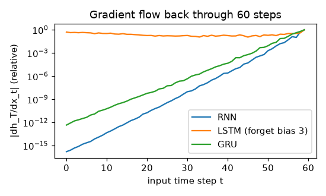

# RNN, LSTM, GRU: forward and backward (NumPy)

**Final metric (this folder is about the layers; training is in `char_lm`):** all three layers
match PyTorch's `nn.RNN / nn.LSTM / nn.GRU` outputs and every gradient (inputs, weights, biases)
to 1e-10, and pass finite-difference checks. Gradient-flow experiment at initialisation, 60 time
steps, hidden size 32: influence of the first input on the last state relative to the last input:

| layer | `|∂h₆₀/∂x₁| / |∂h₆₀/∂x₆₀|` |
|---|---|
| vanilla RNN | 1.7e-16 (vanished) |
| GRU (default init) | 4.6e-13 |
| LSTM, forget-gate bias +3 | **5.2e-1** |

The GRU *can* keep gradients alive (its update gate can learn `z ≈ 1`), but at random init it
does not yet; the LSTM forget-bias trick makes "remember" the default from step one.

## Intuition
An RNN reads a sequence one step at a time and keeps a running **hidden state**: a summary of
everything seen so far. The same weights are used at every step.

Training unrolls the loop into a long chain and backpropagates through it (**BPTT**). The
problem: the gradient from step 60 back to step 1 is multiplied by the recurrent weight matrix
and the tanh slope **60 times**. That product almost always shrinks to nothing (vanishing) or
blows up (exploding), so plain RNNs forget long-range information.

The **LSTM** adds a separate memory lane, the cell state `c`, which is updated by *adding* new
information instead of re-multiplying it through a weight matrix. Gates (numbers between 0 and 1)
decide what to write, what to forget, and what to show. Along the memory lane the gradient is only
scaled by the forget gate, so with `f ≈ 1` it survives many steps. The **GRU** is a lighter version
with two gates and no separate cell.

## Core math
- RNN: `hₜ = tanh(W_ih xₜ + W_hh hₜ₋₁ + b)`. BPTT: `δₜ = (gₜ + δₜ₊₁ W_hh) ⊙ (1 − hₜ²)` → the
  product of Jacobians `Πₖ W_hhᵀ diag(1 − hₖ²)`.
- LSTM (i, f, g, o): `cₜ = f ⊙ cₜ₋₁ + i ⊙ g`, `hₜ = o ⊙ tanh(cₜ)`;
  `∂cₜ₋₁ = ∂cₜ ⊙ f` (the additive "constant error carousel").
- GRU (r, z, n): `n = tanh(W_in x + r ⊙ (W_hn h + b_hn))`, `hₜ = (1 − z) ⊙ n + z ⊙ hₜ₋₁`.
- Parameters: RNN `H(D + H + 2)`, GRU 3×, LSTM 4×.

## Complexity
O(T · N · H · (D + H)) per pass; **sequential in T** (cannot parallelise over time steps).
Memory O(T · N · H) for the cached states (truncated BPTT limits T).

## Common pitfalls
- Exploding gradients: clip the global gradient norm (see `char_lm`).
- Forgetting the gradient coming from the *next* time step (`dh_next`) — the most common BPTT bug.
- Gate order differs between libraries (PyTorch LSTM is i, f, g, o).
- PyTorch's GRU applies the reset gate *after* the hidden matmul (`r ⊙ (W_hn h + b_hn)`); the
  original paper applies it before.
- Zero forget bias: the LSTM starts out forgetting; initialise it to ~1–3.
- Carrying hidden state across batches without detaching (graph grows forever).

## When to use vs. alternatives
- Streaming/online sequence processing, small models, low latency per step → GRU/LSTM.
- Long-range dependencies with lots of data and parallel hardware → transformers.
- Very long sequences with linear cost → state-space models (Mamba/S4) and linear attention.

## Interview questions
1. **Why do vanilla RNNs suffer from vanishing gradients?** BPTT multiplies T Jacobians whose
   norms are typically < 1, so the product decays exponentially.
2. **How does the LSTM fix it?** The cell state is updated additively and its gradient is scaled
   only by the forget gate, giving an uninterrupted path for gradient flow.
3. **LSTM vs GRU?** GRU merges cell and hidden state and uses two gates; fewer parameters,
   often similar accuracy.
4. **How do you handle exploding gradients?** Gradient norm clipping; careful initialisation.
5. **Why did transformers replace RNNs for most NLP?** Attention connects any two positions in one
   step and trains in parallel across the sequence.
