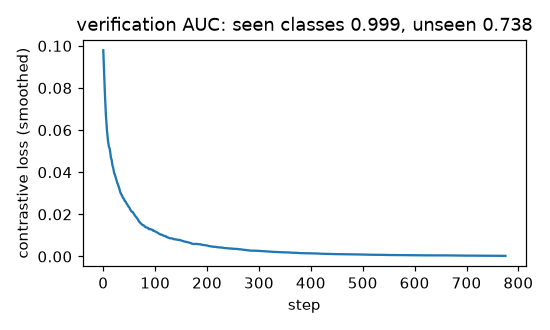

# Siamese network with contrastive loss

**Final metric:** a small CNN (16-d embedding, shared weights) trained for 800 steps on random
pairs of digits **0–6** with the contrastive loss (margin 1). Pair verification, measured as ROC-AUC
of "is this pair the same digit?" using embedding distance, on 2,000 held-out test pairs:

| test pairs | learned embedding | raw-pixel distance |
|---|---|---|
| new images of digits 0–6 (seen classes) | **0.999** | 0.889 |
| digits 7–9 (classes never seen in training) | 0.738 | **0.835** |

**Honest finding:** on unseen classes the learned embedding is *worse* than plain pixel distance.
With only 7 training classes the network learns features that separate *those* digits and throws
away information that 7, 8 and 9 would need. Metric learning transfers to new classes when it is
trained on many diverse classes (face verification trains on thousands of identities). L2-normalising
the embedding and training longer or shorter all stayed in the 0.71–0.75 range.

## Intuition
Instead of a classifier with a fixed set of labels, learn a **similarity**: map every input to a
point in space so that same-class inputs land close together and different-class inputs far apart.
Then "are these two the same person/signature/digit?" is just "is the distance small?". New
classes need no retraining: you can store one example (one-shot) and compare against it.

"Siamese" means both inputs of a pair go through **the same network with the same weights**, so the
distance is symmetric and meaningful.

## Core math
- Distance `d = ‖f(a) − f(b)‖₂`.
- Contrastive loss (Hadsell et al. 2006), per pair: `½ d²` if same,
  `½ max(0, m − d)²` if different. The margin `m` stops pushing pairs already far apart.
- Triplet loss alternative: `max(0, d(a, p) − d(a, n) + m)` with anchor, positive, negative.
- Evaluation: ROC-AUC of `−d` as a score for "same".

## Complexity
Each training example is a pair (two forward passes through the shared network). There are
O(n²) possible pairs, so pairs are sampled; mining hard pairs speeds learning.

## Common pitfalls
- **Collapse:** with only "same" pairs the network maps everything to one point; the negative term
  and margin prevent this.
- Unbalanced pair sampling (random pairs are mostly "different").
- Easy negatives contribute zero loss once past the margin: hard-negative mining helps, too-hard
  (noisy) negatives hurt.
- Evaluating only on seen classes overstates how well the embedding transfers (as the table shows).

## When to use vs. alternatives
- Face/signature verification, one-shot learning, image retrieval, deduplication, recommendation.
- Fixed, known classes with plenty of labels → a plain classifier. Modern embedding learning →
  triplet loss with hard mining, or InfoNCE / CLIP-style contrastive learning over large batches.

## Interview questions
1. **Why share weights between the two branches?** Both inputs must be mapped into the same space;
   sharing also makes the distance symmetric and halves the parameters.
2. **What does the margin do?** Dissimilar pairs only incur loss when closer than `m`, so the model
   does not waste capacity pushing them infinitely apart.
3. **Contrastive vs triplet loss?** Contrastive uses absolute distances on pairs; triplet uses
   relative distances (positive closer than negative by a margin).
4. **How do you do one-shot classification with it?** Embed one labelled example per class; label a
   query with the class of its nearest example.
5. **Why might it fail on new classes?** Too few/too similar training classes: the embedding
   specialises instead of learning general features.
