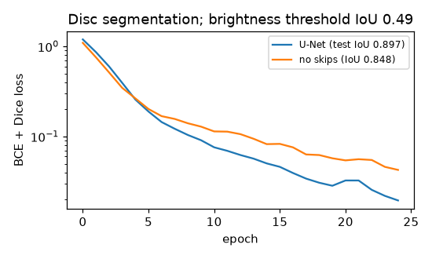

# U-Net on a synthetic segmentation task

**Task:** 32×32 noisy images with 1–3 discs and 1–3 squares, all equally bright; predict the
**disc pixels only**. **Final metric** (800 training / 200 test images, BCE + Dice, Adam 3e-3,
25 epochs, ~6 s on Apple `mps`):

| model | test IoU |
|---|---|
| brightness threshold (> 0.5) | 0.49 |
| encoder-decoder **without** skip connections | 0.85 |
| **U-Net** (with skip connections) | **0.90** |

## Intuition
Segmentation means classifying **every pixel**. You need two kinds of information at once:
- **context** — "this bright pixel is part of a round blob, not a square" — which needs a wide
  view, obtained by repeatedly downsampling;
- **precision** — exactly where the blob's edge is — which downsampling destroys.

A U-Net has an encoder that shrinks the image while widening the channels (context), a decoder
that grows it back (upsampling), and **skip connections** that hand each decoder level the
encoder's full-resolution features from the same level. The decoder then combines "what"
(from below) with "where" (from the skip). The ablation shows it: without skips, the boundaries
come out blurry and IoU drops.

## Core math
- Encoder level: two 3×3 conv–BN–ReLU, then 2×2 max-pool. Decoder level: 2×2 transposed conv
  (stride 2) upsampling, concatenate the skip, two 3×3 conv–BN–ReLU. Final 1×1 conv → per-pixel logit.
- Transposed conv with kernel 2, stride 2: each input pixel paints a learned 2×2 patch.
- Loss: pixel-wise BCE + soft Dice, `1 − (2Σpy + ε)/(Σp + Σy + ε)`; Dice ignores the huge number
  of easy background pixels.
- IoU = `|A ∩ B| / |A ∪ B|` (Jaccard). Dice = `2|A ∩ B|/(|A| + |B|)`; `Dice = 2·IoU/(1 + IoU)`.

## Complexity
Convolutional cost at each resolution; most FLOPs are in the full-resolution levels. Memory is
dominated by the stored encoder activations needed for the skips.

## Common pitfalls
- Pixel accuracy looks great when most pixels are background; report IoU/Dice.
- Spatial size mismatches when concatenating (odd sizes after pooling); pad or crop.
- Checkerboard artefacts from transposed convs (alternatively upsample + conv).
- Class imbalance: combine BCE with Dice or use focal loss.
- Augmentations must transform image and mask identically.

## When to use vs. alternatives
- Medical imaging, satellite imagery, any dense prediction with limited data (U-Nets train well on
  small datasets); also the denoiser inside diffusion models.
- Instance segmentation (separate objects) → Mask R-CNN; large-scale semantic segmentation →
  DeepLab / transformer-based models (SegFormer, SAM).

## Interview questions
1. **Why skip connections in a U-Net?** To restore spatial detail lost during downsampling by
   giving the decoder high-resolution encoder features.
2. **Concatenation vs addition for skips?** U-Net concatenates (decoder can choose how to mix);
   ResNets add (identity path for gradients).
3. **Why Dice loss?** It directly optimises overlap and is robust to class imbalance.
4. **IoU vs Dice?** Monotonically related; Dice weights true positives more heavily.
5. **What does a transposed convolution do?** Learned upsampling: the adjoint (gradient) of a
   strided convolution.
