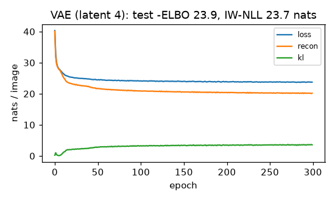
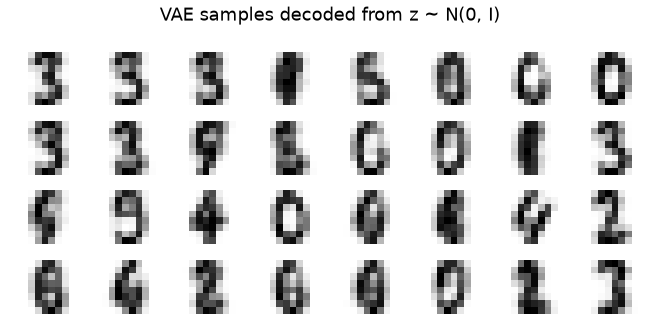

# Variational autoencoder

 

**Final metric:** VAE with a 4-dimensional latent (64→128→(μ, log σ²), decoder 4→128→64, Bernoulli
pixels), Adam, 300 epochs on 8×8 digits. Test **−ELBO 23.9 nats/image** (reconstruction 20.4 +
KL 3.5); importance-weighted estimate of −log p(x) with 200 samples is lower still (tested: the
ELBO is a bound). The baseline "each pixel an independent Bernoulli at its mean" scores 27.1.

Why the margin is modest: the pixels are *grey levels*, so even a perfect decoder pays the binary
cross-entropy of the intermediate values (≈ 13.6 nats/image on this test set). Larger latents (8, 16)
and longer training changed the test −ELBO by under 0.1 nats, so this is close to what a VAE of
this kind can reach here. The samples decoded from random `z ~ N(0, I)` above are recognisable
digits; their nearest real digit is less than half as far away as random noise's (tested). The
4-number latent means give 5-NN accuracy above 0.8 without using labels.

## Intuition
A plain autoencoder's codes are scattered with gaps, so a random code decodes to nonsense. A VAE
forces the codes to fill a known shape, a standard normal cloud, so that *any* point in it decodes
to something plausible.

1. The encoder outputs a small **cloud** (mean and spread) for each image, not a single point.
2. We decode a random point from that cloud, so nearby codes must decode to similar images.
3. A **KL penalty** pulls every cloud toward the standard normal, packing the codes together
   without holes.

Generating = sample from the standard normal, decode.

## Core math
- ELBO: `log p(x) ≥ E_{q(z|x)}[log p(x|z)] − KL(q(z|x) ‖ p(z))`; train by minimising `−ELBO`.
- Gaussian KL in closed form: `½ Σ (μ² + σ² − log σ² − 1)`.
- **Reparameterisation:** `z = μ + σ ⊙ ε`, `ε ~ N(0, I)`, so `∂z/∂μ = 1`, `∂z/∂σ = ε`.
- Gap: `log p(x) − ELBO = KL(q(z|x) ‖ p(z|x))`; importance weighting with k samples tightens it:
  `log p(x) ≈ logsumexp_i[log p(x|zᵢ) + log p(zᵢ) − log q(zᵢ|x)] − log k`.
- β-VAE: weight the KL by β (>1 for more disentangled, blurrier results).

## Complexity
Same as an autoencoder plus O(latent) for sampling and the KL term.

## Common pitfalls
- Using the variance instead of the log-variance as the network output (negative variances, instability).
- Mismatched reduction: summing reconstruction over pixels but averaging the KL (or vice versa)
  silently changes β.
- **Posterior collapse:** a powerful decoder ignores z and KL → 0; use KL annealing or a weaker decoder.
- Blurry samples: Gaussian/Bernoulli likelihoods average over uncertainty.
- Reporting the ELBO as if it were the exact log-likelihood.

## When to use vs. alternatives
- Smooth, structured latent spaces; representation learning; generation with likelihoods;
  anomaly detection; as the compressor inside latent diffusion models.
- Sharper samples → GANs or diffusion models. Exact likelihood → normalising flows / autoregressive models.

## Interview questions
1. **What is the reparameterisation trick?** Writing `z = μ + σε` so sampling is a differentiable
   function of the parameters and backprop works.
2. **What are the two terms of the ELBO?** Reconstruction (expected log-likelihood) and KL to the prior.
3. **Why is the ELBO a lower bound?** `log p(x) = ELBO + KL(q(z|x) ‖ p(z|x))` and KL ≥ 0.
4. **What is posterior collapse?** The decoder models the data without using z, so the encoder
   matches the prior and the KL term vanishes.
5. **VAE vs autoencoder?** A VAE is probabilistic and regularised to a prior, so its latent space
   can be sampled; a plain AE only learns to reconstruct.
