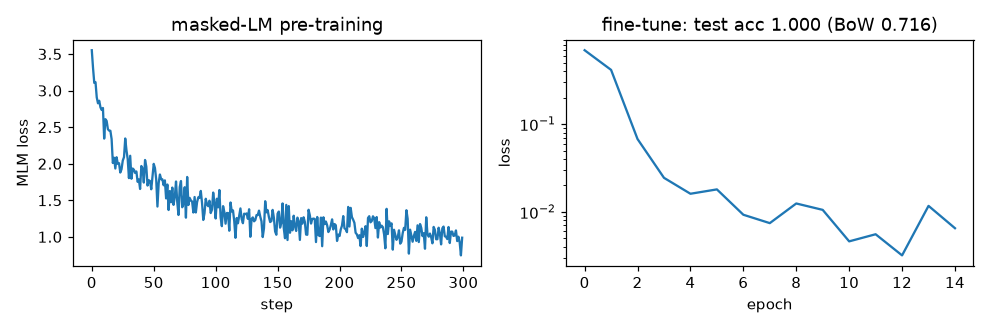

# Tiny BERT-style encoder for sentiment

**Dataset (generated, offline):** movie-review sentences such as *"the plot was not very good but
the music was really great"*. A clause's sentiment is its adjective flipped by "not", and in
"A but B" sentences clause B decides. 4,000 training / 1,000 test sentences, balanced labels.

**Final metric:** 2-layer, 4-head, d = 64 encoder, built from this repo's multi-head attention.
Pre-trained for 300 steps with masked-language modelling, then fine-tuned for 15 epochs on the [CLS]
token (~17 s on CPU). **Test accuracy 1.000**, versus **0.716** for logistic regression on unigram +
bigram counts. A bag of words can't tell whether "not" applies to the adjective in the deciding
clause, or which clause comes after "but".

## Intuition
BERT is the *encoder* half of the transformer: every token attends to every other token, both to its
left and its right (no causal mask). That makes it excellent at **understanding** a whole input
(classification, tagging, retrieval embeddings) but not at generating text left-to-right.

- A special **[CLS]** token is placed first. After the layers it has attended to the whole sentence,
  so its final vector serves as the sentence summary fed to a small classifier.
- **Masked language modelling** pre-training: hide 15% of words and train the model to fill them in
  from context on both sides. This needs no labels and teaches general language structure; the
  model is then **fine-tuned** on the labelled task.

## Core math
- Input: `LN(token_emb + position_emb)`; layers: post-norm `LN(x + MHA(x))`, `LN(x + FFN(x))` with
  padding keys masked.
- Classification: `softmax(W₂ tanh(W₁ h_[CLS]))`, cross-entropy.
- MLM masking: choose 15% of tokens; 80% → `[MASK]`, 10% → random token, 10% unchanged; loss only on
  chosen positions. (The 10%/10% stop the model relying on the `[MASK]` symbol, which never appears
  at fine-tuning time.)
- Tested properties: changing a *later* word changes *earlier* positions' representations
  (bidirectional); changing padding changes nothing.

## Complexity
O(L · (T² d + T d²)) per sentence; one forward pass gives the whole-sentence representation.

## Common pitfalls
- Not masking padding in attention (padding tokens then influence real tokens).
- Using a causal mask by mistake (turns it into a weak GPT).
- Learning rate too high for fine-tuning a pre-trained model (catastrophic forgetting); typical 1e-5–5e-5 for real BERT.
- Max length truncation dropping the decisive clause.
- Synthetic data is easy to solve perfectly; real sentiment data has sarcasm, noise and label ambiguity.

## When to use vs. alternatives
- Classification, named-entity tagging, extractive QA, sentence embeddings for retrieval.
- Bag-of-words + linear models: fast baseline when order rarely matters.
- Generation tasks → decoder (GPT) or encoder-decoder (T5). Today large decoder LLMs are also used
  zero-shot for classification, at much higher cost.

## Interview questions
1. **BERT vs GPT?** BERT is a bidirectional encoder trained with masked LM; GPT is a causal decoder
   trained with next-token prediction. BERT for understanding, GPT for generation.
2. **Why the 80/10/10 masking scheme?** To reduce the mismatch between pre-training (which has
   `[MASK]`) and fine-tuning (which doesn't), and to keep all token representations informative.
3. **What is the [CLS] token for?** A position whose final state summarises the sequence for
   classification.
4. **Why does bag-of-words fail on this data?** It discards order, so it cannot tell which adjective
   "not" modifies or which clause follows "but".
5. **Pre-training vs fine-tuning?** Self-supervised learning on unlabelled text, then supervised
   adaptation of all (or some) weights on a small labelled set.
