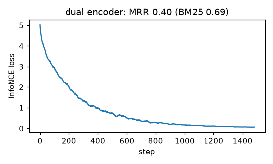

# Dense retrieval: an embedding model and vector indexes (brute force + IVF)

## Results
**Vector index** (20,000 clustered unit vectors in 32-d, 200 queries, top-10, IVF with 64 cells):

| n_probe | recall vs exact | vectors compared per query |
|---|---|---|
| 1 | 0.90 | 348 (1.7%) |
| 4 | 1.00 | 1,313 (6.6%) |
| 64 (all cells) | 1.00 (= brute force) | 20,000 |

**Embedding model:** a dual encoder (mean of learned word embeddings → linear → unit vector, 128-d)
trained from scratch for 1,500 steps with InfoNCE and in-batch negatives on self-supervised pairs
from the notes corpus (a sentence of a passage ↔ another passage of the same topic; no queries used).
On the 430 held-out interview questions over 432 passages of the frozen corpus snapshot (numbers from
[`results.txt`](results.txt), written by the slow test), MRR@10:

| | MRR@10 |
|---|---|
| untrained encoder (random embeddings, averaged) | 0.30 |
| **trained dual encoder** | **0.40** |
| BM25 (`s5_nlp/bm25`) | **0.69** |
| reciprocal-rank fusion of BM25 + dense (top 50 each, k = 60) | 0.55 |

**Why this number has moved:** the corpus is the repository's own notes, so it changed as topics were
added. The trained encoder's MRR was 0.33 when first measured (401 passages; 400 training steps,
64-d), 0.40 after tuning to 1,500 steps and 128-d (406 passages), and drifted between 0.40 and 0.42 as
later notes (including this file) were written. The evaluation now uses a frozen snapshot of the notes,
[`s5_nlp/corpus_snapshot.json`](../corpus_snapshot.json) (432 passages, 430 questions), so the 0.40 above
is reproducible; regenerate it deliberately with `python -m s5_nlp.corpus`. The conclusion never
changed: training helps, and BM25 stays far ahead.

**Honest finding:** training helps, but a dense model learned from ~400 passages is far behind BM25,
and fusing it in hurts. Its training loss goes to ~0: it memorises the 86 topics rather than learning
general meaning. Dense retrieval wins when the encoder is **pre-trained on huge corpora** (e.g.
sentence-transformers, E5) and tested on paraphrased queries. Here the questions share many exact
terms with the notes, which suits BM25.

## Intuition
Turn every passage and every query into a vector so that "relevant" means "close". Search is then a
nearest-neighbour lookup, and the vectors can capture meaning beyond exact words ("automobile" near
"car"), *if* the encoder has learned language from enough data.

**Brute force** compares the query with every vector: exact but O(N). **IVF** (inverted file) groups
the vectors into clusters with k-means; a query only scans the few clusters whose centres are nearest.
A true neighbour sitting just across a cluster border is missed, so `n_probe` trades recall for speed.

## Core math
- Encoder: `f(text) = normalize(W · mean(E[tokens]))`; similarity = cosine = dot product of unit vectors.
- InfoNCE: `L = −(1/B) Σᵢ log( exp(qᵢ·pᵢ/τ) / Σⱼ exp(qᵢ·pⱼ/τ) )`, τ = 0.05; the other passages in the
  batch are the negatives. (One pair per topic per batch avoids false negatives.)
- IVF: k-means centroids `c₁..c_L`; query cost ≈ `L + (n_probe/L)·N` vector comparisons.
- Recall vs exact = `|ANN top-k ∩ exact top-k| / k`.

## Complexity
Brute force O(N·d) per query (fast with BLAS for up to ~10⁶ vectors). IVF build = k-means
O(iters·N·L·d); query ~O((L + N·n_probe/L)·d). Memory O(N·d) for both (product quantisation compresses it).

## Common pitfalls
- Comparing unnormalised vectors with dot product (long vectors win) or mixing metrics.
- IVF with too few training points per cell, or `n_probe = 1` on borderline queries.
- Evaluating a dense retriever on queries that overlap its training pairs (leakage).
- Small in-batch negatives make contrastive training too easy; hard negatives help.
- Expecting a from-scratch encoder on a tiny corpus to beat BM25 (it did not here).

## When to use vs. alternatives
- Semantic search, RAG, recommendation, deduplication — with a pre-trained embedding model.
- Exact/rare terms, no training data → BM25. Best practice: hybrid retrieval plus a reranker.
- Larger indexes: IVF-PQ (FAISS), HNSW graphs (hnswlib, most vector databases), ScaNN.

## Interview questions
1. **Bi-encoder vs cross-encoder?** Bi-encoders embed query and document separately (indexable, fast);
   cross-encoders read them together (more accurate, used to rerank a short list).
2. **What are in-batch negatives?** Using the other examples' positives in the batch as negatives,
   giving B−1 negatives per query for free.
3. **How does IVF speed up search and what does it cost?** Scans only the nearest clusters; may miss
   neighbours in unprobed clusters (lower recall).
4. **IVF vs HNSW?** IVF partitions by clustering (cheap memory, tunable n_probe); HNSW navigates a
   multi-layer proximity graph (excellent recall/latency, more memory, slower builds).
5. **Why might BM25 beat dense retrieval?** Domain shift or small training data for the encoder, and
   queries dominated by exact keywords.
