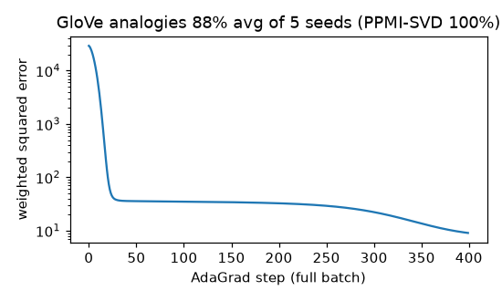

# GloVe (small)

**Final metric:** 30-d GloVe (window 5, x_max 10, α 0.75, full-batch AdaGrad, 400 steps) on the same
planted-structure synthetic corpus as `word2vec`. Planted-analogy accuracy over 5 random seeds:
**1.00, 0.94, 0.98, 0.65, 0.81 (mean 0.88)**; random vectors: 2%. A count-based baseline (positive PMI
+ truncated SVD) scores **1.00** every time. word2vec (SGNS) also scored 1.00.

**Honest finding:** on a ~50-word vocabulary GloVe is unstable. Training longer (lower loss) or
using a larger `x_max` made analogies *worse*, e.g. 2,000 steps dropped one run from 0.75 to 0.27.
The weighted least-squares fit has enough dimensions to fit noise in every log count. On large
corpora GloVe and SGNS perform similarly; on tiny data the closed-form PPMI-SVD is the safer choice.

## Intuition
word2vec learns from one (word, context) pair at a time. GloVe first counts how often every pair of
words co-occurs in the whole corpus, then finds vectors whose dot products reproduce the
**logarithm of those counts**. The key observation (Pennington et al.) is that *ratios* of
co-occurrence probabilities carry meaning: `P(solid | ice) / P(solid | steam)` is large,
`P(water | ice) / P(water | steam)` ≈ 1. Fitting log counts turns ratios into vector differences, which
is why analogies show up as straight-line offsets.

## Core math
- Co-occurrence `X_ij = Σ 1/distance` within the window.
- Objective: `J = Σ_{X_ij > 0} f(X_ij) (wᵢ·c̃ⱼ + bᵢ + b̃ⱼ − log X_ij)²`.
- Weighting: `f(x) = (x/x_max)^α` for `x < x_max`, else 1 — down-weights noisy rare pairs and caps
  frequent ones.
- Gradients: with `e_ij = f·(prediction − log X)`, `∂J/∂W = 2EC`, `∂J/∂C = 2EᵀW`, `∂J/∂b = 2Σⱼ e_ij`
  (finite-difference checked). Final vectors `W + C`.
- AdaGrad: `θ ← θ − η g / √(Σ g²)`.

## Complexity
Building X: O(tokens × window). Each epoch: O(non-zero entries × d) (here full-batch O(V² d) since V is
tiny). Memory O(V²) for X (sparse in practice).

## Common pitfalls
- Including zero counts (log 0); they must be skipped.
- Forgetting the weighting function: frequent pairs like ("the", ·) dominate.
- Over-training on small corpora (above).
- Comparing W alone vs W + C (W + C is usually slightly better).
- Building X for a large vocabulary as a dense matrix.

## When to use vs. alternatives
- Pre-trained GloVe vectors are a common, cheap feature set. Train-from-scratch: SGNS, fastText, or
  GloVe depending on tooling; contextual embeddings (BERT) for most modern tasks.
- Very small data: PPMI + SVD.

## Interview questions
1. **GloVe vs word2vec?** GloVe fits global co-occurrence counts (log-bilinear regression); word2vec
   learns from local windows by SGD. They are closely related (both factorise PMI-like matrices).
2. **Why the weighting function?** Rare co-occurrences are noisy and very frequent ones uninformative;
   `f` balances them and is 0 for unseen pairs.
3. **Why log counts?** So that dot products model log probabilities and ratios become differences.
4. **Why add the two vector tables?** The objective is symmetric; summing reduces noise.
5. **What is PPMI?** `max(0, log P(i,j)/(P(i)P(j)))`: how much more often two words co-occur than chance.
