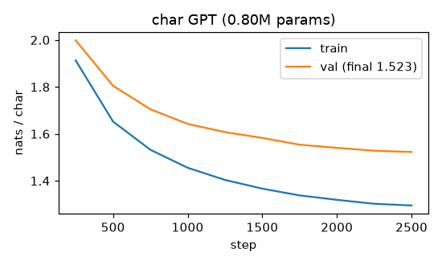

# Decoder-only transformer (GPT-style) on tiny-shakespeare

**Final metric:** 4 layers, 4 heads, d_model 128, context 128 characters, RoPE, weight tying
(**0.80 M parameters**). Trained for 2,500 steps of batch 64 with AdamW (lr 1e-3, warm-up 100 then
cosine, weight decay 0.1, dropout 0.1, gradient clipping 1.0), about 1.5 minutes on Apple `mps`.
**Validation loss 1.523 nats/char** (perplexity ≈ 4.6) on the last 10% of tiny-shakespeare;
train loss 1.29. For comparison: unigram baseline 3.40, NumPy char-LSTM 1.63 (`s4_deep_learning/char_lm`,
trained on less data). Sample in [`sample.txt`](sample.txt). The trained weights are cached at
`data/gpt_char_shakespeare.pt` (gitignored) and reused by `s5_nlp/lora`.

## Intuition
A GPT reads a sequence and, at every position, predicts the next token. Each layer has two parts:
1. **Causal self-attention** — every position gathers information from earlier positions (never
   later ones, so training on all positions at once is still honest next-token prediction).
2. **MLP** — processes each position's gathered information on its own.
Both are wrapped in residual connections with layer norm before them ("pre-norm"), forming a
"residual stream" that each layer reads from and writes back to.

**Generation** is a loop: predict a distribution, pick a token, append it, repeat. The **KV cache**
stores each layer's keys and values for the tokens already processed, so each new token only
computes its own query/key/value instead of recomputing the whole prefix (tested: identical output,
faster). **Sampling** controls creativity: temperature rescales the logits, top-k keeps only the k
most likely tokens, top-p keeps the smallest set whose probabilities sum to p.

## Core math
- Embedding `x₀ = E[tokens]` (positions enter via RoPE inside attention).
- Block: `x ← x + Attn(LN(x))`, `x ← x + MLP(LN(x))`, MLP = Linear(d, 4d) → GELU → Linear(4d, d).
- Output logits `= LN(x_L) Eᵀ` (weight tying: the same matrix embeds and un-embeds).
- Loss: mean cross-entropy over all positions. Init: N(0, 0.02), residual projections scaled by
  `1/√(2L)` (GPT-2), so loss at init ≈ `ln V` (tested).
- KV cache: at step t, `q_t` attends over cached `K_{≤t}, V_{≤t}`; RoPE uses the absolute offset t.
- Top-p: sort probabilities, drop a token when the probabilities before it already sum to ≥ p.

## Complexity
Training: O(L · T · d² + L · T² · d) per sequence. Generation without cache: O(T²) work per new token
(O(T³) total); with cache O(T) per token, at the cost of O(L · T · d) memory for keys/values.

## Common pitfalls
- Off-by-one between inputs and targets; leaking future tokens through the mask (tested causality).
- KV cache with the wrong position offset for RoPE (tested against full recompute).
- Generating past `block_size` (the model never saw those positions).
- Evaluating with dropout on (`model.eval()`).
- Weight decay on LayerNorm and bias parameters (excluded here).
- Comparing losses across different tokenizers (nats/char vs nats/token).

## When to use vs. alternatives
- Any autoregressive generation: text, code, music, even pixels. Encoders (BERT, `bert_classifier`) are
  better for classification/retrieval embeddings; encoder-decoders (T5) for input → output tasks.

## Interview questions
1. **What does the causal mask do and why does it allow parallel training?** Each position sees only
   the past, so all T next-token predictions are valid simultaneously.
2. **What is the KV cache and what does it cost?** Stored keys/values of past tokens; makes each
   decoding step O(T) instead of recomputing O(T²), using memory proportional to layers × T × d.
3. **Pre-norm vs post-norm?** Pre-norm (LN before each sublayer) keeps a clean residual path and
   trains stably without careful warm-up.
4. **Temperature, top-k, top-p?** Temperature sharpens/flattens; top-k truncates to k tokens; top-p
   truncates to the smallest set with cumulative probability p (adapts to the model's confidence).
5. **Why weight tying?** Fewer parameters and a consistent mapping between input and output token
   spaces; usually improves perplexity for small models.
