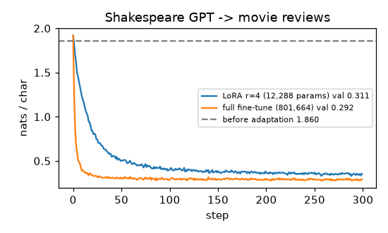

# LoRA by hand, applied to the tiny GPT

**Final metric:** the Shakespeare character GPT (`s5_nlp/gpt`, 801,664 parameters) adapted to a new
domain — lowercase movie-review sentences from `bert_classifier`'s generator — for 300 steps.
Validation loss on held-out reviews (nats/char):

| | trainable parameters | val loss |
|---|---|---|
| before adaptation | – | 1.860 |
| **LoRA, r = 4, α = 8 on q/k/v + output projections** | **12,288 (1.5%)** | **0.311** |
| full fine-tuning | 801,664 (100%) | 0.292 |

LoRA recovers 99% of full fine-tuning's improvement while training 1.5% of the parameters. After
`merge_lora` the adapters are folded into the weights, so inference costs exactly the same as the
original model (tested: outputs unchanged by merging).

## Intuition
Fine-tuning a big model normally updates every weight and needs a full copy of the model per task.
LoRA's bet: the *change* a task needs is simple, so it can be written as a low-rank matrix
`ΔW = B·A`, where A squeezes the input down to r numbers and B expands them back. Freeze the
original W, train only A and B. A 128×384 matrix (49k numbers) gets an adapter of 4×(128 + 384) = 2k
numbers. One base model can carry many tiny adapters, one per task, and swap them.

B starts at zero, so training starts from exactly the pretrained model (tested).

## Core math
- `h = W x + (α/r) · B A x`, `W ∈ ℝ^{d_out×d_in}` frozen, `A ∈ ℝ^{r×d_in}` (Kaiming init),
  `B ∈ ℝ^{d_out×r}` (zeros).
- `rank(ΔW) ≤ r`; trainable parameters `r(d_in + d_out)` per adapted matrix.
- `α/r` scaling keeps the update size roughly independent of r, so the learning rate needn't change with r.
- Merge for inference: `W ← W + (α/r) B A`; unmerge to switch adapters.
- Gradients flow only into A and B (tested; gradcheck passes).

## Complexity
Training memory falls sharply (no optimiser state for frozen weights: Adam keeps 2 extra copies of
each trainable parameter). Compute per step is about the same as full fine-tuning (the backward pass
still runs through the frozen layers). Inference after merging: unchanged.

## Common pitfalls
- Forgetting to freeze the base weights (then it is just full fine-tuning plus extra parameters).
- Initialising both A and B randomly: the model no longer starts at the pretrained function.
- Rank too small for a big domain shift; target only some layers (here attention) and decide whether
  to include the MLPs.
- Using the full fine-tuning learning rate: LoRA usually wants a larger one (3e-3 vs 1e-3 here).
- Merging, then continuing to train the adapter (double counting); unmerge first.

## When to use vs. alternatives
- Adapting large models on limited GPU memory; serving many task-specific variants of one base model.
- QLoRA: LoRA on top of a 4-bit quantised base. Other parameter-efficient methods: adapters (small
  bottleneck MLPs), prefix/prompt tuning, IA³. Full fine-tuning when data is large and compute allows.

## Interview questions
1. **What does LoRA assume?** The weight update needed for adaptation has low intrinsic rank.
2. **Why initialise B to zero?** So ΔW = 0 at the start and the adapted model equals the pretrained one.
3. **Does LoRA slow down inference?** Not after merging ΔW into W.
4. **Where does the memory saving come from?** No gradients/optimiser states for frozen weights; only
   r(d_in + d_out) parameters per adapted layer are trained and stored per task.
5. **What does α do?** Scales the update (`α/r`), decoupling the effective step size from the rank.
