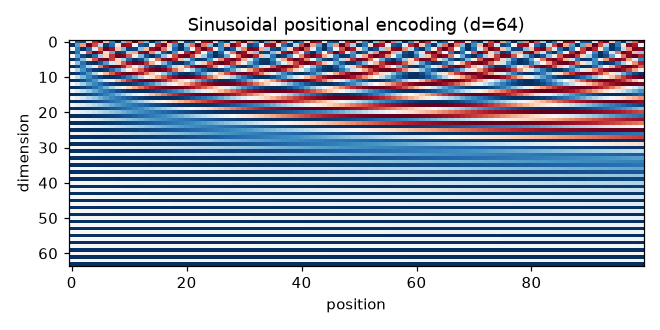

# Positional encodings: sinusoidal and RoPE

## Intuition
Attention by itself has no idea of order: shuffle the words and each word's output is simply
shuffled too (tested in `attention`). Something must tell the model *where* each token is.

- **Sinusoidal (absolute):** give every position a fixed fingerprint made of sine and cosine waves
  of many different wavelengths, like the hands of many clocks turning at different speeds, and
  **add** it to the token embedding. Fast waves distinguish neighbours; slow waves distinguish
  distant regions.
- **RoPE (rotary, relative):** instead of adding anything, **rotate** each query and key vector by an
  angle proportional to its position (each pair of dimensions at its own speed). When a query at
  position m meets a key at position n, the two rotations combine into a rotation by `m − n`, so
  attention scores depend only on the *distance* between tokens. Used by Llama, Mistral, GPT-NeoX.

## Core math
- Sinusoidal: `PE[p, 2i] = sin(p·ωᵢ)`, `PE[p, 2i+1] = cos(p·ωᵢ)`, `ωᵢ = 10000^(−2i/d)`;
  wavelengths from 2π to 2π·10000. Each (sin, cos) pair has norm 1.
- Shift property: `PE[p + k] = PE[p] · R_k` for a fixed block-diagonal rotation `R_k` (tested), so a
  linear layer can read relative offsets.
- RoPE: for each pair `(x₂ᵢ, x₂ᵢ₊₁)` at position m, rotate by `m·θᵢ`:
  `(x₂ᵢ cos − x₂ᵢ₊₁ sin, x₂ᵢ sin + x₂ᵢ₊₁ cos)`, i.e. multiply the complex number `x₂ᵢ + i·x₂ᵢ₊₁` by `e^{i m θᵢ}`
  (both forms implemented and compared).
- `⟨R_m q, R_n k⟩ = ⟨q, R_{n−m} k⟩` ⇒ scores depend on `m − n` only (tested: score(5, 2) = score(50, 47)).
- Rotations preserve norms; position 0 is the identity.

## Complexity
O(T·d) to compute/apply; negligible next to attention. Tables are precomputed.

## Common pitfalls
- RoPE applied to values (it should be queries and keys only).
- Interleaved pairs (2i, 2i+1) vs "half split" (i, i + d/2) layouts differ between codebases; weights
  are not interchangeable.
- Forgetting the position offset when decoding with a KV cache (new token is at position t, not 0).
- Learned absolute embeddings cannot extrapolate past the training length; RoPE degrades gracefully
  and can be extended (position interpolation, NTK scaling).
- Scaling: embeddings are often multiplied by √d before adding sinusoidal encodings.

## When to use vs. alternatives
- Modern decoder LLMs: RoPE. Original transformer / many encoders: sinusoidal or learned absolute
  embeddings (BERT, GPT-2). Other relative schemes: ALiBi (linear distance penalty), T5 relative buckets.

## Interview questions
1. **Why do transformers need positional encodings?** Self-attention is permutation-equivariant; it
   cannot otherwise distinguish orderings.
2. **Why sines and cosines of geometric frequencies?** Unique, bounded codes for every position, and a
   shift is a fixed linear map, which makes relative position learnable.
3. **How does RoPE encode relative position?** Rotating q and k by position-dependent angles makes
   their dot product depend only on the position difference.
4. **Added vs multiplicative encodings?** Sinusoidal/learned are added to embeddings once; RoPE is
   applied inside every attention layer to q and k.
5. **What happens beyond the training context length?** Learned absolute embeddings have no vector;
   RoPE sees unfamiliar angles and degrades unless scaled.
