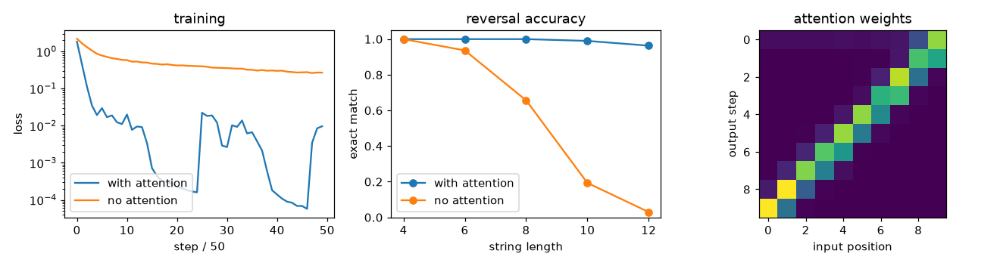

# Seq2seq with Bahdanau attention

**Final metric:** bidirectional-GRU encoder + GRU decoder (embedding 32, hidden 64), Adam, 2,500
steps of batch 64 (~40 s per model on CPU), trained to **reverse** random strings of 3–12 letters.
Exact-match accuracy on 300 fresh strings per length:

| length | 4 | 6 | 8 | 10 | 12 |
|---|---|---|---|---|---|
| **with attention** | 1.00 | 1.00 | 1.00 | 0.99 | **0.96** |
| no attention | 1.00 | 0.94 | 0.66 | 0.19 | **0.03** |

The attention map (right panel) is the anti-diagonal: to write output letter t the decoder looks at
input position L − 1 − t, which is exactly the right alignment for reversal (tested: > 80% of peaks).

## Intuition
A plain encoder-decoder reads the whole input, squeezes it into **one** vector, and the decoder must
regenerate everything from that vector. That bottleneck is fine for short inputs and fails for long
ones (see the "no attention" row).

**Attention** removes the bottleneck. The encoder keeps a vector for *every* input position. At each
output step the decoder asks "which input positions matter right now?", gets a weight for each, and
reads a weighted average (the *context*). For reversal it learns to look at the input from the back
to the front.

## Core math
- Encoder states `hⱼ = [→hⱼ; ←hⱼ]` (bidirectional GRU), initial decoder state `s₀ = tanh(W[→h_L; ←h_1])`.
- Bahdanau (additive) score: `eₜⱼ = vᵀ tanh(W_s sₜ₋₁ + W_h hⱼ)`; weights `αₜ = softmax(eₜ)` over real
  (unpadded) positions; context `cₜ = Σⱼ αₜⱼ hⱼ`.
- Decoder: `sₜ = GRU([emb(yₜ₋₁); cₜ], sₜ₋₁)`, `P(yₜ) = softmax(W_o [sₜ; cₜ])`.
- Training: teacher forcing (true previous token as input), cross-entropy ignoring padding,
  gradient clipping at norm 1. Inference: greedy decoding with the model's own predictions.

## Complexity
O(T_in · T_out · d) for attention plus the recurrent cost; decoding is sequential in T_out.

## Common pitfalls
- Not masking padded encoder positions (attention leaks onto padding). Packed sequences keep padding
  out of the encoder (tested: extra padding does not change the encoding).
- Exposure bias: trained with teacher forcing, tested on its own outputs, so errors compound.
- Forgetting the end-of-sequence token, so decoding never knows when to stop.
- Measuring token accuracy instead of exact match for tasks where one wrong token ruins the output.

## When to use vs. alternatives
- Historical baseline for translation/summarisation and the direct ancestor of the transformer.
- Today: transformer encoder-decoders (T5, BART) or decoder-only LMs; RNN seq2seq still fits small,
  streaming or low-latency settings.

## Interview questions
1. **What problem does attention solve in seq2seq?** The fixed-size bottleneck vector: the decoder can
   look back at all encoder states.
2. **Additive (Bahdanau) vs multiplicative (Luong) attention?** Additive scores with a small MLP;
   multiplicative uses a (scaled) dot product, which is faster and is what transformers use.
3. **What is teacher forcing and its downside?** Feeding ground-truth previous tokens during
   training; mismatch with inference (exposure bias).
4. **Why a bidirectional encoder?** Each position's state then summarises both its left and right
   context.
5. **Greedy vs beam search?** Greedy takes the best token each step; beam search keeps the k best
   partial sequences and usually finds higher-probability outputs.
