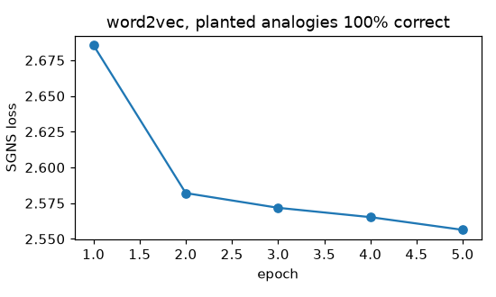

# word2vec: skip-gram with negative sampling, similarity, analogies

**Final metric:** 30-dimensional SGNS embeddings (window 4, 5 negatives, 5 epochs, NumPy) trained on
a 4,000-sentence **synthetic corpus with planted structure**: eight nouns (king, queen, prince,
princess, man, woman, boy, girl) defined by three binary attributes (gender, royal/common,
adult/child), each sentence containing a noun plus context words drawn from its attributes.
**96/96 planted analogies correct (100%)** with 3CosAdd (random embeddings: < 30%). Nearest
neighbours of `king`: queen, man, prince (one attribute away each); of `he`: his, him, himself
(cosine 0.98–0.99).

Why synthetic: it makes the right answers known, so the test is about correctness rather than
"looks plausible", and it needs no download. On real text the same code works but needs millions
of tokens for good analogies.

## Intuition
"You shall know a word by the company it keeps." Words that appear in similar contexts get
similar vectors. Skip-gram turns this into a prediction task: from a word, predict the words
around it. The vectors that make this prediction work become the embeddings.

Predicting the exact neighbour out of the whole vocabulary (a huge softmax) is expensive.
**Negative sampling** asks an easier yes/no question: "is this (word, context) pair real, or did I
make it up by picking a random context word?" That is logistic regression with a few random
"negative" words per real pair.

Why analogies work: if `king` ≈ `royal + male + adult` and `queen` ≈ `royal + female + adult` in
vector space, then `king − man + woman` lands on `queen`, because the "male" and "female" directions
are the same everywhere.

## Core math
- Score `s = u_o · v_c` (context vector · center vector).
- Loss per positive pair with k negatives: `−log σ(u_o·v_c) − Σᵢ log σ(−u_{nᵢ}·v_c)`.
- Gradients: `∂L/∂v_c = (σ(s_o) − 1) u_o + Σᵢ σ(s_{nᵢ}) u_{nᵢ}`, `∂L/∂u_o = (σ(s_o) − 1) v_c`,
  `∂L/∂u_{nᵢ} = σ(s_{nᵢ}) v_c` (finite-difference checked).
- Negatives ~ unigram^0.75. SGNS implicitly factorises the shifted PMI matrix
  `PMI(w, c) − log k` (Levy & Goldberg 2014).
- Analogy (3CosAdd): `argmax_d cos(d, b − a + c)` excluding a, b, c.

## Complexity
O(pairs × k × d) per epoch; independent of vocabulary size (that is the point of negative sampling).

## Common pitfalls
- Not excluding the query words in analogy search (the answer is usually `b` itself).
- Using raw frequency for negatives (too many "the"); use the 0.75 power and subsample frequent words.
- Comparing un-normalised vectors (use cosine).
- Evaluating analogies on a vocabulary that misses the test words.
- Expecting embeddings to separate senses: one vector per word mixes meanings ("bank").

## When to use vs. alternatives
- Cheap word features, similarity search, initialising models, studying semantics/bias.
- GloVe (co-occurrence factorisation, `s5_nlp/glove`) gives similar quality; fastText adds subword
  n-grams for rare/misspelled words; contextual embeddings (BERT/GPT) give a vector per occurrence.

## Interview questions
1. **Skip-gram vs CBOW?** Skip-gram predicts context from the center word (better for rare words);
   CBOW predicts the center from averaged context (faster).
2. **Why negative sampling?** It replaces an O(V) softmax with k + 1 binary classifications.
3. **Why unigram^0.75 for negatives?** It balances sampling frequent and rare words.
4. **Why do vector analogies work?** Consistent relationships correspond to consistent offset
   directions in the embedding space (a linear structure in log co-occurrence statistics).
5. **What does SGNS optimise implicitly?** A factorisation of the PMI matrix shifted by log k.
