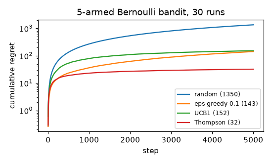

# Multi-armed bandits: epsilon-greedy, UCB, Thompson sampling

**Final metric:** 5 Bernoulli arms with success rates 0.10, 0.30, 0.50, 0.55, 0.70; cumulative regret
after 5,000 pulls, averaged over 30 runs (lower is better):

| strategy | regret |
|---|---|
| random play | 1,350 |
| ε-greedy (ε = 0.1) | 143 |
| UCB1 | 152 |
| **Thompson sampling** | **32** |

ε-greedy's regret keeps growing at a constant rate (it explores 10% of the time forever); UCB1's and
Thompson's growth slows down (sub-linear, ~log T), both tested. UCB1 is close to ε-greedy at this
horizon because its exploration bonus is conservative; it pulls ahead over longer runs.

## Intuition
You face several slot machines with unknown payout rates and a fixed number of pulls. Every pull spent
on a machine you're unsure about is *exploration*; every pull on the current favourite is *exploitation*.
Too little exploration and you may get stuck on a mediocre arm; too much and you waste pulls.

- **ε-greedy:** usually play the best-looking arm, occasionally a random one.
- **UCB:** be optimistic: score each arm by its average *plus* a bonus that is large when it has been
  tried only a few times; play the highest score.
- **Thompson sampling:** keep a belief (a probability distribution) about each arm's rate; imagine one
  plausible rate per arm by sampling from those beliefs; play the arm whose imagined rate is highest.
  Uncertain arms sometimes get lucky draws and get explored; clearly bad arms rarely do.

## Core math
- Regret: `R_T = Σₜ (μ* − μ_{aₜ})` (pseudo-regret, using true means).
- Incremental mean: `Q ← Q + (r − Q)/n`.
- UCB1 (Auer et al. 2002): `aₜ = argmax_a Q_a + √(2 ln t / n_a)`, regret `O(Σ_{a} ln T / Δ_a)`.
- Thompson (Beta-Bernoulli): posterior `Beta(1 + successes, 1 + failures)`; sample `θ_a`, play `argmax θ_a`;
  also logarithmic regret, often the best in practice.
- Lai-Robbins lower bound: any consistent strategy needs Ω(log T) regret.

## Complexity
O(k) per step for all three (a Beta sample per arm for Thompson). Memory O(k).

## Common pitfalls
- Fixed ε: linear regret; decay it (e.g. ε ∝ 1/t) or use UCB/Thompson.
- Forgetting to try every arm once before UCB (division by zero).
- Ties: always picking arm 0 among equal estimates biases ε-greedy; break ties randomly.
- Non-stationary rewards: plain averages adapt slowly; use a constant step size or sliding windows.
- Measuring regret with realised rewards (noisy) instead of the true means when you know them.

## When to use vs. alternatives
- A/B/n testing with adaptive traffic, recommendation and ad selection, hyperparameter search,
  clinical-trial-like allocation.
- Context matters (user features) → contextual bandits (LinUCB, neural Thompson). Actions change future
  states → full reinforcement learning (`dynamic_programming`, `td_learning`).

## Interview questions
1. **What is the exploration-exploitation trade-off?** Gathering information about uncertain options vs
   using the best-known option.
2. **Why does UCB work?** Optimism: an arm is played either because it is good or because it is uncertain;
   the bonus shrinks with more pulls, so bad arms are tried only O(log T) times.
3. **How does Thompson sampling explore?** Through posterior uncertainty: each arm is chosen with the
   probability that it is optimal.
4. **Regret of ε-greedy with fixed ε?** Linear in T, because it keeps exploring at a constant rate.
5. **Bandits vs A/B tests?** A/B tests split traffic evenly and pay full regret during the test;
   bandits shift traffic toward the winner as evidence accumulates.
