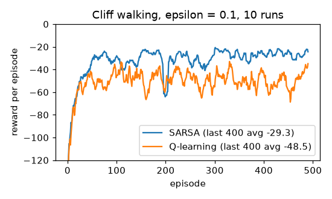

# Q-learning and SARSA on a gridworld



**Final metric** (cliff walking, ε = 0.1, α = 0.5, γ = 1, 500 episodes, averaged over 10 runs):

| | greedy policy's return after training | average reward per episode while learning (episodes 100–500) |
|---|---|---|
| **Q-learning** | **−13 (optimal: the cliff edge)** | −48.5 |
| **SARSA** | −17 (a safer route two rows up) | **−29.3** |

This reproduces Sutton & Barto's Figure 6.4. Q-learning learns the optimal path but keeps falling off
the cliff while exploring along it; SARSA accounts for its own exploration and prefers a safer path, so
it earns more *during* learning. On the slippery world (slip 0.1, γ = 0.95, 3,000 episodes) Q-learning's
greedy policy is worth **−15.83**, exactly the dynamic-programming optimum, learned without ever seeing
the transition model.

SARSA's greedy policy:
```
>>>>>>>>>>vv
^^^>^^>>^^>v
^^^>^<<^^>>v
^CCCCCCCCCCG
```

## Intuition
Dynamic programming needs the rules of the world. **Temporal-difference (TD) learning** learns from
experience instead: act, see what happens, and nudge your estimate toward "the reward you just got plus
what you now think the next state is worth". You learn from a guess about the future, updated one step at
a time (bootstrapping), without waiting for the episode to end.

- **SARSA** (on-policy) uses the action it will *actually* take next, including random exploratory moves,
  so it learns the value of its own cautious, exploring behaviour.
- **Q-learning** (off-policy) uses the *best* next action, so it learns the value of acting optimally even
  while behaving randomly some of the time.

## Core math
- TD error: `δ = target − Q(s, a)`; update `Q(s, a) ← Q(s, a) + α δ`.
- SARSA target: `r + γ Q(s', a')` with `a' ~ ε-greedy(Q)`, the actual next action.
- Q-learning target: `r + γ max_b Q(s', b)`.
- Terminal transitions: target `= r`.
- Convergence (tabular): Q-learning → Q* if every (s, a) is visited infinitely often and α decays suitably;
  SARSA → Q* if ε also decays to 0 (GLIE).

## Complexity
O(1) per step; memory O(|S|·|A|) for the table.

## Common pitfalls
- Bootstrapping from the terminal state (its value must be 0).
- Using the greedy action instead of the actually-taken a' in SARSA (that turns it into Q-learning).
- No exploration (ε = 0 from the start): the agent never discovers better paths.
- Fixed learning rate in stochastic environments: estimates keep fluctuating (smaller α helps, as in
  the slippery experiment).
- Judging an agent by its training returns vs its greedy policy: they answer different questions (above).

## When to use vs. alternatives
- Small discrete problems without a known model. Known model → DP (`dynamic_programming`).
  Large/continuous state spaces → function approximation (DQN = Q-learning with a neural net,
  replay buffer, target network); policy-gradient / actor-critic methods for continuous actions.

## Interview questions
1. **On-policy vs off-policy?** On-policy (SARSA) evaluates the policy it follows; off-policy
   (Q-learning) learns about a different (greedy) policy from exploratory data.
2. **Why does SARSA take the safer cliff path?** Its targets include exploratory actions, so states near
   the cliff look dangerous under the ε-greedy policy it actually runs.
3. **What is bootstrapping?** Updating an estimate from other current estimates (`Q(s')`) rather than
   waiting for the full return.
4. **TD vs Monte Carlo?** TD updates every step with lower variance but some bias; Monte Carlo waits for
   the episode's actual return (unbiased, higher variance).
5. **What makes DQN stable where naive deep Q-learning is not?** Experience replay (decorrelates
   samples) and a slowly updated target network (stabilises the bootstrap target).
